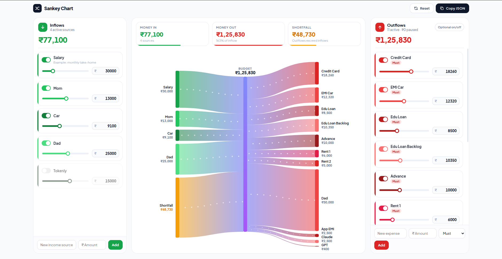

# Sankey Chart

A simple page to see where your money goes each month.

Add your income on the left, your expenses on the right, and the chart in the middle shows how the money flows from one to the other.

**Live:** <https://cash.tokenly.in>



## How to use

1. Open the page. It starts with some example numbers so you can see how it works.
2. On the left, change the income amounts or add your own. Remove the examples with the **x** button.
3. On the right, do the same for your expenses.
4. Watch the chart in the middle update as you type or move a slider.

The three boxes at the top of the chart show:

- **Money in:** total of all income that is switched on
- **Money out:** total of all expenses that are switched on
- **Surplus** or **Shortfall:** what is left over, or how much you are short

If you spend more than you earn, the missing amount shows up on the left side of the chart as **Shortfall**. If you earn more, the extra shows up on the right as **Surplus**.

## Features

- Switch any item on or off to see what happens without deleting it
- Mark expenses as **Must** or **Optional** (click the tag to change it)
- Turn all optional expenses on or off with one button
- Hover over the chart or a card to highlight that flow
- **Copy JSON** copies all your numbers so you can save or share them
- **Reset** brings back the example numbers
- Works on phone and desktop

## Your data

Everything stays in your own browser. Nothing is sent to a server. Your numbers are saved in the browser's local storage, so they are still there when you come back. If you clear your browser data or use a private window, they will be gone.

## Run it locally

There is no build step. It is a single `index.html` file.

Open `index.html` in your browser, or start a small local server:

```bash
python3 -m http.server 8000
```

Then go to <http://localhost:8000>.

## Deploy

The site is hosted on GitHub Pages and deployed with GitHub Actions (`.github/workflows/production.yml`).

One-time setup in the GitHub repo:

1. **Settings > Pages:** set **Source** to **GitHub Actions**.
2. **Settings > Secrets and variables > Actions:** add a secret named `DEPLOYMENT_EMAIL`.
3. **Settings > Pages > Custom domain:** enter `cash.tokenly.in`, then turn on **Enforce HTTPS**.
4. At your DNS provider, add a `CNAME` record for `cash` pointing to `thenameisvicky.github.io`.

To deploy:

1. Go to **Actions > Production > Run workflow**.
2. Enter the same email you saved in `DEPLOYMENT_EMAIL`.
3. The workflow checks the email, then publishes `index.html` to GitHub Pages.

## Built with

Plain HTML, CSS and JavaScript. The chart is drawn with SVG. No libraries or frameworks.
